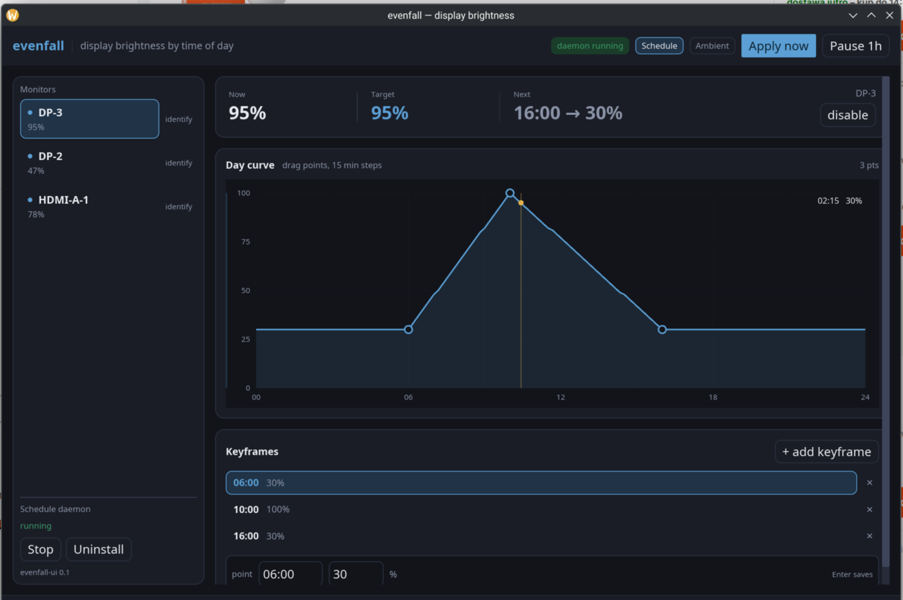

# evenfall — display brightness by time of day.

Keeps every monitor on a brightness curve instead of one fixed value. Dusk
starts dim, the middle of the day is bright, and nothing jumps.

Two parts, one config:

- **`evenfall`** — a small daemon that recomputes the curve and writes brightness
  through `kscreen-doctor`, so KDE stays the owner of display state and its own
  sliders and brightness keys keep working.
- **`evenfall-ui`** — a iced desktop app for editing the curves: drag keyframes on
  the day chart, add or delete points, pause the schedule.

```
06:00        10:00              16:00                 06:00
 30%    ↗     80%      ↘         30%    ——— flat ———   30%   DP-3
 10%    ↗     50%      ↘         10%    ——— flat ———   10%   DP-2
 50%    ↗     80%      ↘         50%    ——— flat ———   50%   HDMI-A-1
```

## Install

```sh
./evenfall install                     # CLI + config + systemd user service
cd ui && ./install.sh              # build the UI, install it and its launcher
```

`evenfall install` seeds the config from the brightness the monitors currently
show, so the first run does not change anything. The service starts with the
KDE session and survives suspension.

## Configuration

`~/.config/evenfall/config.toml` (`evenfall path` prints the exact location):

```toml
tick = 60              # seconds between recalculations (min 10)
reassert_minutes = 0   # >0: force the value every N minutes

[defaults]             # shared curve for monitors without their own section
"07:00" = 55
"22:00" = 10

[monitors.DP-3]
"06:00" = 30
"10:00" = 80
"16:00" = 30

[monitors.DP-2]
enabled = false        # leave this monitor alone
```

- `mode = "schedule"` follows the clock, `mode = "ambient"` follows a lux
  sensor (see below).
- Values are percentages, 0–100, interpolated linearly between keyframes.
- Keyframes on both sides of midnight close the loop (16:00 → 06:00 stays flat).
- Monitor names are the connectors from `kscreen-doctor -o`
  (`DP-3`, `HDMI-A-1`, `eDP-1`).
- The file is reloaded on every tick and the UI rewrites it on every edit, so
  hand edits and the UI do not fight.

## Ambient mode

`mode = "ambient"` replaces the clock with an illuminance reading: brightness
follows lux through a log-interpolated curve, so a dark evening dims the
screens and daylight pushes them up.

```toml
mode = "ambient"
ambient_timeout = 300      # seconds without a sample before falling back to the clock
ambient_deadband = 2       # percent of change worth a DDC/CI write
http_bind = "127.0.0.1:8787"
http_token = ""

[ambient]                  # shared lux -> brightness curve
"5" = 10
"50" = 25
"300" = 55
"1000" = 85

[ambient."DP-2"]           # optional per-monitor override
"5" = 5
"500" = 40
```

Samples arrive over HTTP, which is all Home Assistant needs:

```sh
curl -X POST -H 'X-Evenfall-Token: secret' \
     -d '{"lux": 320}' http://desktop:8787/lux
```

`GET /status` answers with the mode, the last sample and its age. When no
sample arrives for `ambient_timeout` seconds the daemon falls back to the
schedule, so a dead sensor never freezes the screens at a random value.

Home Assistant (on its own mini PC) only needs to push the sensor value:

```yaml
rest_command:
  evenfall_lux:
    url: "http://desktop:8787/lux"
    method: POST
    headers:
      X-Evenfall-Token: !secret evenfall_token
    payload: '{"lux": {{ states("sensor.office_illuminance") | float(0) }} }'

automation:
  - alias: evenfall ambient sample
    triggers:
      - trigger: time_pattern
        minutes: "/2"
    actions:
      - action: rest_command.evenfall_lux
```

Keep `http_bind` on loopback and reach it over Tailscale, or bind the tailnet
address and set `http_token`. Without a token, anyone who can reach the port can
move your brightness.

## Command line

```sh
evenfall status               # current vs scheduled brightness, next change
evenfall preview              # the day curve as a sparkline
evenfall apply                # apply now (overrides manual changes)
evenfall apply --dry-run      # show what would be written
evenfall identify DP-2        # flash a monitor so you know which one it is
evenfall identify             # flash every monitor in turn
evenfall mode                 # print the current mode
evenfall mode ambient         # follow the light sensor instead of the clock
evenfall lux 320              # record a reading without Home Assistant
evenfall pause 2h             # leave the screens alone (film, presentation, photos)
evenfall resume
systemctl --user restart evenfall        # restart the daemon
journalctl --user -u evenfall -f         # watch brightness changes
```

## UI



`evenfall-ui` reads the same config, shows the live brightness of every monitor and
lets you drag keyframes: 15-minute steps across, 1% up and down. Every edit is
saved and applied on the spot. Points refuse to land on top of each other, so
dragging past a neighbour never deletes it.

Each monitor row has an “identify” action: it flashes that screen three times
between 100% and 10% and puts the brightness back, so a connector name maps to a
physical panel without guessing. The same lives in `evenfall identify`.

The header switches between Schedule and Ambient. In ambient mode it also shows
the last lux reading and how old it is, so a silent sensor is obvious.

The sidebar owns the schedule daemon: install it, start or stop it, and remove
it again without leaving the app. “Pause 1h” mutes the schedule without
touching the config.

## How it works

- Every tick reads the brightness KDE reports, compares it with the curve and
  writes only what differs, in one atomic `kscreen-doctor` call.
- A manual brightness change is not fought immediately; the curve returns at
  the next keyframe. Use `evenfall pause` for a longer break.
- After resuming from suspend, or when a display is plugged in, values are
  re-asserted because KDE restores its own saved brightness.
- Internal panels (`eDP-1`) use the same mechanism, so laptops need nothing
  extra.

## Requirements

- KDE Plasma 6 with `kscreen-doctor` on `$PATH`.
- Monitors with DDC/CI enabled in their OSD (LG: *Settings → General → DDC/CI*).
- Python 3.11+ for the daemon (standard library only); Rust toolchain to build
  the UI.

## Uninstall

```sh
./evenfall uninstall          # remove the service, keep the config
./evenfall uninstall --purge  # remove config, state and binary as well
```

## License

MIT, see [LICENSE](LICENSE).
